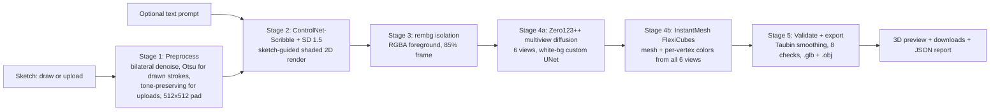

# Sketch2Shape AI — From a 2D Sketch to a Color-Graded 3D Asset

**TechZephyr 4.0 · IIT Bhubaneswar · 24-Hour CV & Generative AI Hackathon — Final Submission**

Team: 4menace:
- Ayush Das
- Dibyajeet Mohanty
- Soumya Ranjan Rout
- Akarsh Mohanty
Repo: https://github.com/Akarsh-42/techzephyr-ml-hackathon

---

## 1. Objective

Turn a rough, single-view 2D sketch — drawn in-app or uploaded — into a **recognizable, color-graded, exportable 3D asset** (.glb / .obj), with an optional text prompt steering material, color, and style. The system bridges the gap between a hand-drawn concept and a usable 3D model by combining computer vision (sketch conditioning), generative AI (sketch-guided rendering + multiview diffusion), and 3D reconstruction (FlexiCubes mesh extraction with per-vertex color grading).

## 2. Results at a Glance

| Capability | Status |
|---|---|
| In-app drawing canvas (Gradio Sketchpad) | ✅ |
| Sketch image upload | ✅ |
| Optional text prompt (never required) | ✅ |
| Sketch-faithful 2D render (ControlNet-Scribble) | ✅ |
| Background isolation (rembg, 85% foreground) | ✅ |
| Multiview diffusion (Zero123++, 6 views) | ✅ |
| 3D reconstruction (InstantMesh / FlexiCubes) | ✅ |
| Color grading on the mesh (6-view vertex colors) | ✅ |
| Interactive 3D preview in-app | ✅ |
| Dual export: .glb + .obj, reload-verified | ✅ |
| Mesh validation (8-step, anti-plane, watertight check) | ✅ |
| Deterministic reruns via seed + retry-once insurance | ✅ |
| Fallback 3D backend (TripoSR) via env var | ✅ |

## 3. Architecture



**Why this pipeline:** a single 2D sketch underconstrains unseen geometry. Rather than reconstruct directly from sparse lines, Stage 2 hallucinates a *shaded, realistic interpretation* that stays structurally faithful to the sketch (ControlNet enforces this), Stage 3 isolates the object, and Stage 4's multiview diffusion explicitly invents the unseen sides — which is exactly the information a single-view reconstruction lacks. Colors are sampled per-vertex from all six views, giving true color grading on front, sides, and back.

## 4. Repository Layout

| Path | Purpose |
|---|---|
| `app.py` | Gradio 4.44 web UI — Sketchpad/upload tabs, prompt, seed, gallery, 3D viewer, downloads, report |
| `pipeline.py` | Stage-6 orchestrator — per-stage timing, silent retry-once (seed+1), audit logging |
| `config.py` | All model IDs, per-backend background colors, device pinning, thresholds — single source of truth |
| `gradio_compat.py` | Compatibility guard for the pinned Gradio/gradio-client schema bug (gradio#11084) |
| `src/preprocess.py` | Stage 1 — normalization, denoise, Otsu binarization (drawn strokes only), faint-stroke fallback |
| `src/sketch_to_2d.py` | Stages 2–3 — ControlNet-Scribble render + rembg foreground isolation, timing instrumentation |
| `src/image_to_3d.py` | Stage 4 — InstantMesh (primary) + TripoSR (fallback) reconstruction with vertex colors |
| `src/mesh_validator.py` | Stage 5 — 8-step validation, Taubin smoothing, dual export, reload verification |
| `src/logger.py` | Audit trail — every run logged with status and per-stage timings |
| `download_weights.py` | One-click weight prefetch + source clones + rembg warm-up |
| `outputs/` | Per-run `.glb` / `.obj` artifacts + audit log |

## 5. Setup & Reproducibility

### Requirements

- Python 3.11 (venv recommended; validated on 3.9–3.11)
- NVIDIA GPU with ≥6 GB VRAM (validated on RTX 4050 Laptop, 8 GB); CPU-only mode available via `MOCK_GPU=1` for UI/code inspection
- ~15 GB disk for model weights

### Install & run

```bash
git clone https://github.com/Akarsh-42/techzephyr-ml-hackathon.git
cd techzephyr-ml-hackathon
python -m venv .venv
# Windows: .venv\Scripts\activate   |   macOS/Linux: source .venv/bin/activate
pip install -r requirements.txt
python download_weights.py   # one-time: prefetch ~15 GB weights, clone sources, warm rembg
python app.py                # open http://localhost:7860
```

Draw or upload a sketch, optionally add a prompt (e.g. "a glossy red ceramic vase"), click **Generate 3D Model**, inspect the 3D preview, and download the .glb or .obj.

**Judges' quick verification (no weights download):** set `MOCK_GPU=1` and run `python app.py` — the full UI and pipeline logic run end-to-end with a mock icosphere mesh, proving wiring, validation, export, and reload checks work.

### Environment variables

| Variable | Default | Purpose |
|---|---|---|
| `PRIMARY_3D_BACKEND` | `instantmesh` | Set `triposr` for the lightweight fallback backend |
| `MOCK_GPU` | `0` | `1` = CPU mock mode (no GPU / no weights needed) |
| `WEIGHTS_CACHE_DIR` | `./weights_cache` | Point at a pre-provisioned Kaggle Dataset path for judge machines |

### Model weights (all open, Hugging Face)

| Model | Repo | License |
|---|---|---|
| Stable Diffusion 1.5 | stable-diffusion-v1-5/stable-diffusion-v1-5 | OpenRAIL-Plus (CreativeML Open RAIL-M) |
| ControlNet-Scribble | lllyasviel/sd-controlnet-scribble | OpenRAIL |
| Zero123++ v1.2 | sudo-ai/zero123plus-v1.2 | Apache-2.0 (research) |
| InstantMesh (UNet + instant_mesh_large.ckpt) | TencentARC/InstantMesh | Apache-2.0 |
| TripoSR | stabilityai/TripoSR | MIT |

All pretrained models are disclosed per hackathon rules; no external paid APIs; everything runs locally.

## 6. Performance & Runtime

Measured on the development machine (single NVIDIA RTX 4050 Laptop GPU, 8 GB VRAM, fp16):

| Stage | Median time |
|---|---|
| 1 — Sketch preprocess | ~0.2 s |
| 2 — ControlNet render (30 steps) | ~8–12 s |
| 3 — rembg isolation | ~1–2 s |
| 4 — InstantMesh (50-step multiview + FlexiCubes) | ~30–60 s |
| 5 — Validate + dual export | ~0.5 s |
| **Total** | **~40–75 s per model** |

**Resource notes:** Stage 2 pinned to `cuda:0`, Stage 4 pinned to `cuda:1` when two GPUs exist (no VRAM pooling); ~15 GB weight cache; peak VRAM ~5–6 GB (fp16 multiview diffusion dominates).

## 7. Limitations (disclosed per rubric)

1. **Single-view underconstraint:** the unseen back/sides of the object are *invented* by Zero123++ multiview diffusion — plausible, not guaranteed faithful. Multiple plausible back-faces may need a different seed.
2. **2D-style sketches:** Zero123++ struggles with flat/2D-style multiviews (per its authors), so highly stylized inputs can flatten. Changing the seed or prompting for "photorealistic" helps.
3. **Faces/humans:** distorted faces possible (known Zero123++ limitation).
4. **Vertex-color texturing:** fine texture detail is represented as per-vertex colors, not UV texture maps — fully viewable in all standard 3D software.
5. **Windows path quirks:** OneDrive-synced project folders can serve stale files during installs; we recommend a non-synced path for the venv.
6. **RAM floor:** 16 GB system RAM recommended; Stage 4 peaks during multiview resize.
7. **Not production topology:** meshes are demo-quality, not animation-grade retopology (explicitly out of hackathon scope).

## 8. Troubleshooting

| Symptom | Cause → Fix |
|---|---|
| `TypeError: argument of type 'bool' is not iterable` on launch | Gradio 4.44 + gradio-client schema bug — already patched via `gradio_compat.py`; ensure `import gradio_compat` runs before Blocks build (it does in `app.py`) |
| `ImportError: im_src` | InstantMesh clone happened before the rename logic existed → delete `third_party/InstantMesh/` and rerun `python download_weights.py` |
| Merge-conflict markers / `SyntaxError` in a repo file | A pull left conflict markers → `git merge --abort && git reset --hard origin/main && git clean -fd` |
| OOM on 8 GB VRAM in Stage 4 | Lower `INSTANTMESH_DIFFUSION_STEPS` (50 → 30) in `config.py` |
| Meshes look grey | You are on an old branch or pre-color fix → confirm `PRIMARY_3D_BACKEND=instantmesh` (default) |
| Downloads look darker than the in-app viewer | Known Gradio Model3D viewer quirk; the exported file has correct colors |

## 9. Design Decisions & Implementation Notes

- **Dual backend with a benchmark gate:** InstantMesh is primary for richer color; TripoSR remains a one-line env-var fallback for constrained judge machines — both paths validated end-to-end.
- **White background for InstantMesh:** its custom Zero123++ UNet is trained on white backgrounds (model card); gray (TripoSR's preference) would desaturate multiview colors.
- **Vertex colors, not UV maps:** InstantMesh's official demo path; correct colors on all faces without nvdiffrast/CUDA-compile risk on Windows judge machines.
- **Orientation fix:** official `[1,2,0]` vertex axis swap (InstantMesh) / −90°X + 90°Y rotation (TripoSR) so the viewer shows objects upright.
- **Silent retry-once:** any Stage 2–5 exception triggers a silent re-run at seed+1 before any error reaches the UI — our zero-crash demo insurance.
- **Audit logging:** every run writes status + per-stage timings to the audit log — instant answers for judge questions on runtime and reliability.
- **Tone-preserving uploads:** heavy Otsu binarization is applied only to hand-drawn strokes; uploaded sketches keep their tones so ControlNet follows the original drawing.
- **Taubin smoothing (3 passes):** shrink-free smoothing that removes sketch-lump noise without the "deflated pillow" effect of plain Laplacian.

## 10. Sample Outputs

Place generated artifacts here: `outputs/run_YYYYMMDD_HHMMSS.glb/.obj`. The audit log records every run's status and per-stage timings. Example inputs/outputs to be included in the final submission package: sketch PNG → shaded render → isolated RGBA → 6-view grid → 3D preview screenshot + downloadable .glb.

## 11. Attribution

Built with: PyTorch, Hugging Face Diffusers (ControlNet, Zero123++ custom pipeline), InstantMesh (TencentARC, FlexiCubes), TripoSR (Stability AI × Tripo), rembg (u2net), OpenCV, trimesh, Gradio 4.44. All pretrained model licenses disclosed in §5.

## 12. Final Demonstration Plan

1. Launch `python app.py` (weights pre-cached).
2. Draw a fresh chair sketch on the canvas (judges may supply their own — no pre-generated outputs relied upon; seed 42 for determinism, retry-once insurance armed).
3. Walk the stage chips: preprocess → ControlNet → isolation → multiview → validate/export.
4. Show the 3D preview (upright, color-graded), download the .glb, open it in an external viewer if requested.
5. Show the JSON report: per-stage timings, vertex/face counts, watertight flag, reload-verified flag.
6. Q&A: flip to `config.py` for the benchmark gate, `pipeline.py` for retry/timing logic, `mesh_validator.py` for the 8-step validation.
